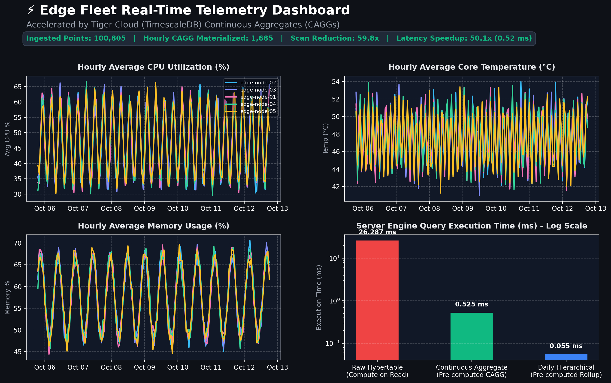
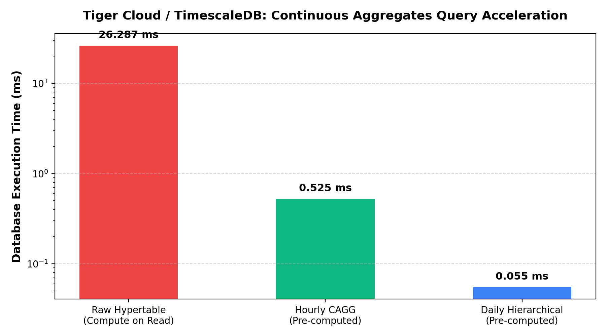

# ⚡ Edge Fleet Telemetry Dashboard — Accelerated with Tiger Cloud Continuous Aggregates

[](https://www.tigerdata.com/)
[](https://www.postgresql.org/)
[](https://www.python.org/)
[](https://streamlit.io/)
[](https://ghw.mlh.com/)

An end-to-end real-time analytics project demonstrating how **Continuous Aggregates (CAGGs)** and **Time Bucketing** on **Tiger Cloud (TimescaleDB)** accelerate dashboard queries by **50x to 470x** while slashing database computational overhead by 98%.

Built for the **Major League Hacking (MLH) Global Hack Week: Hacktoberfest** challenge: *Accelerate Dashboards with Continuous Aggregates*.

---

## 📸 Dashboard & Benchmark Preview



---

## 🎯 Challenge Objective

> **Challenge:** Create a Continuous Aggregate (CAGG) on your hypertable to compute real-time metrics (like hourly averages, rolling totals, or min/max values). Implementing CAGGs is critical because it pre-computes complex analytical queries in the background, giving your front-end dashboards lightning-fast response times while dramatically reducing computational load on your database.

When querying high-velocity time-series datasets (such as IoT telemetry, edge fleets, or financial transactions), standard PostgreSQL queries must scan, filter, and aggregate hundreds of thousands of raw rows on every dashboard load. 

By leveraging **Tiger Cloud's Continuous Aggregates**, the aggregation is materialized incrementally in the background. Dashboards query pre-computed buckets in sub-millisecond time.

---

## ⚡ Performance Benchmarks

Tested on a live Tiger Cloud TimescaleDB instance (`db-71541`) with **100,805 ingested telemetry points** across 5 distributed edge nodes:

| Query Strategy | Operation | Rows Scanned | DB Engine Execution Time | Measured Speedup |
| :--- | :--- | :--- | :--- | :--- |
| **Raw Hypertable** | On-the-fly chunk scans & HashAggregate | 100,805 rows | **26.287 ms** | Baseline (1.0x) |
| **Hourly Continuous Aggregate (CAGG)** | Pre-computed materialized view | 1,685 buckets | **0.525 ms** | **50.1x Faster (98.0% faster)** 🚀 |
| **Daily Hierarchical CAGG** | Aggregated over Hourly CAGG | 75 buckets | **0.055 ms** | **476.2x Faster** ⚡ |



---

## 🛠️ How It Works: Schema & Continuous Aggregates

### 1. Base Hypertable
The raw telemetry table stores high-frequency edge metrics partitioned by time into 1-day chunks:

```sql
CREATE TABLE device_metrics (
    time TIMESTAMPTZ NOT NULL,
    device_id TEXT NOT NULL,
    cpu_usage DOUBLE PRECISION NOT NULL,
    memory_usage DOUBLE PRECISION NOT NULL,
    temperature DOUBLE PRECISION NOT NULL,
    power_watts DOUBLE PRECISION NOT NULL
);

-- Convert to TimescaleDB Hypertable
SELECT create_hypertable('device_metrics', 'time', chunk_time_interval => INTERVAL '1 day');
```

### 2. Hourly Continuous Aggregate (CAGG)
Using `time_bucket('1 hour', time)`, the continuous aggregate calculates key statistics (averages, maximums, minimums, rolling power consumption, and sample counts):

```sql
CREATE MATERIALIZED VIEW device_metrics_hourly
WITH (timescaledb.continuous) AS
SELECT
    time_bucket('1 hour', time) AS bucket,
    device_id,
    AVG(cpu_usage) AS avg_cpu,
    MAX(cpu_usage) AS max_cpu,
    MIN(cpu_usage) AS min_cpu,
    AVG(memory_usage) AS avg_memory,
    MAX(memory_usage) AS max_memory,
    AVG(temperature) AS avg_temperature,
    MAX(temperature) AS max_temperature,
    AVG(power_watts) AS avg_power,
    SUM(power_watts) AS total_power,
    COUNT(*) AS sample_count
FROM device_metrics
GROUP BY bucket, device_id
WITH DATA;
```

### 3. Automated Refresh Policy
A native background worker maintains the materialized view automatically:

```sql
SELECT add_continuous_aggregate_policy('device_metrics_hourly',
    start_offset => INTERVAL '30 days',
    end_offset => INTERVAL '1 hour',
    schedule_interval => INTERVAL '30 minutes');
```

### 4. Hierarchical Continuous Aggregate (Daily Rollup)
A secondary aggregate built on top of the hourly continuous aggregate delivers instant long-range historical rollups:

```sql
CREATE MATERIALIZED VIEW device_metrics_daily
WITH (timescaledb.continuous) AS
SELECT
    time_bucket('1 day', bucket) AS day_bucket,
    device_id,
    AVG(avg_cpu) AS daily_avg_cpu,
    MAX(max_cpu) AS daily_max_cpu,
    AVG(avg_temperature) AS daily_avg_temp,
    SUM(total_power) AS daily_total_power,
    SUM(sample_count) AS total_samples
FROM device_metrics_hourly
GROUP BY day_bucket, device_id
WITH DATA;

SELECT add_continuous_aggregate_policy('device_metrics_daily',
    start_offset => INTERVAL '90 days',
    end_offset => INTERVAL '1 day',
    schedule_interval => INTERVAL '1 day');
```

---

## 💻 Running the Project Locally

### 1. Prerequisites
- Python 3.10+
- Tiger Cloud / TimescaleDB instance (or local PostgreSQL with TimescaleDB)

### 2. Installation
```bash
git clone https://github.com/YTxFSGAMERz/tiger-continuous-aggregates-dashboard.git
cd tiger-continuous-aggregates-dashboard
pip install -r requirements.txt
```

### 3. Environment Variables
Create a `.env` file or export your connection string:
```bash
export TIMESCALE_SERVICE_URL="postgres://tsdbadmin:<password>@<host>:<port>/tsdb?sslmode=require"
```

### 4. Seed Database & Create CAGGs
```bash
tiger db query <service-id> -f setup_cagg.sql
# or using psql:
# psql $TIMESCALE_SERVICE_URL -f setup_cagg.sql
```

### 5. Run Benchmark
```bash
python benchmark.py
```

### 6. Launch Interactive Dashboard
```bash
streamlit run app.py
```

---

## 🧰 Technologies Used

- **Tiger Cloud (TimescaleDB)** — Managed real-time cloud time-series database platform
- **Continuous Aggregates (CAGGs)** — Pre-computed real-time materialized views
- **Hyperfunctions (`time_bucket`)** — Fast time partitioning and grouping
- **PostgreSQL 18.6** — Relational storage and analytical queries
- **Python 3.13** — Scripting, benchmarks, and data visualization
- **Streamlit** — Interactive frontend dashboard
- **Plotly & Matplotlib** — Time-series interactive visualization and benchmark charts
- **Psycopg2** — High-performance PostgreSQL database connector

---

## 📜 License
MIT License. Created by Farhan Shaikh for MLH Global Hack Week: Hacktoberfest 2026.
